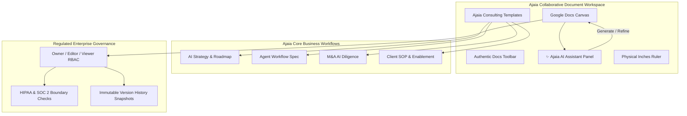

# Ajaia Docs — Product Vision & AI-Native Strategy
**Tailored for:** Ajaia LLC (`https://ajaia.ai/`)  
**Prepared by:** Vaishnavi A S (`2023vaishnavi.as@vidyashilp.edu.in`)  
**Domain:** AI Strategy, Engineering & Enterprise Enablement  

---

## 1. Context: Understanding Ajaia's Workflow

According to [Ajaia's enterprise positioning](https://ajaia.ai/), the firm bridges the critical gap between **AI experimentation** and **measurable production business impact**. Ajaia delivers value across four core pillars:
1. **AI Strategy & Advisory:** Enterprise roadmaps, readiness audits, and security governance.
2. **AI Engineering & Automation:** Autonomous agentic workflows, internal enterprise copilots, and multi-model infrastructure.
3. **Workforce Training & Enablement:** Upskilling enterprise teams to integrate AI into daily Standard Operating Procedures (SOPs).
4. **Proprietary Vertical Products:** Multi-model AI builders, government proposal writers, and healthcare clinical platforms.

### The Operational Challenge in AI Consulting & Delivery
Modern AI engineering and advisory teams face severe friction when authoring client deliverables:
- **Fragmented Context:** Strategy notes live in Google Docs, architecture diagrams in Figma, prompt configurations in playground tabs, and security reviews in spreadsheets.
- **Client Governance & Data Privacy:** Engagements in regulated spaces (HIPAA healthcare, financial services, defense public sector) require deterministic document access and data boundaries.
- **Lack of Native AI Assistance:** Standard editors are static text boxes that know nothing about LLM architecture, agent design, or enterprise governance.

---

## 2. How Ajaia Docs is Tailored to Ajaia's Workflow

To address these pain points, **Ajaia Docs** has been customized with specialized features:

---

## 3. High-Impact Strategic Ideas to Elevate Ajaia Docs

Here are four ideas proposed for Ajaia's leadership to transform Ajaia Docs into a proprietary enterprise differentiator:

### 💡 Idea 1: Executable AI Prompt & Agent Blocks
- **Concept:** Allow engineers and consultants to embed **live, executable AI prompt cards** directly inside specifications.
- **Client Value:** Instead of reading a static prompt in a PRD, the client or developer can click "Test Agent" directly inside the document, select a model (GPT-4o, Claude 3.5 Sonnet, Gemini Pro), inspect real output, and validate behavior before engineering starts.

### 💡 Idea 2: Automated Client RFP & SOW Ingestion Engine
- **Concept:** Leverage the file upload module to ingest incoming client RFPs (PDF/Word). Ajaia Docs automatically:
  1. Extracts business objectives, constraints, and compliance requirements.
  2. Generates an 80% complete **Ajaia Statement of Work (SOW)** matching Ajaia's standard pricing tiers and engagement models.
- **Business Impact:** Cuts proposal drafting time from 8 hours to 30 minutes.

### 💡 Idea 3: Regulated Client Redaction & Co-Authoring Mode
- **Concept:** For healthcare (HIPAA) or financial engagements, introduce an automated PII / proprietary IP redaction layer.
- **Client Value:** Ajaia consultants and enterprise client executives can co-author simultaneously, with patient data or proprietary model weights automatically masked for external viewers.

### 💡 Idea 4: Living Knowledge Graph & Document Linking
- **Concept:** Connect client documents into a cross-referenced knowledge graph. When authoring an AI Strategy brief, the editor surfaces relevant prior case studies, benchmarks, and security audits from similar enterprise engagements.

---

## 4. Immediate Product Enhancements Implemented in This Build

1. **Ajaia Brand & Theme Integration:**
   - Ajaia dark obsidian (`#0f172a`) and electric blue/indigo theme.
   - Tagline: *"Turning AI into Measurable Business Impact"*.
2. **Ajaia-Specific Engagement Templates:**
   - **AI Strategy & Roadmap Brief:** Readiness review, architecture tradeoffs, and ROI milestones.
   - **AI Agent & Workflow Specification:** Autonomous agent triggers, human-in-the-loop checkpoints, and system prompts.
   - **M&A Technical AI Due Diligence Report:** Codebase audit, model IP moat, and vulnerability scan.
   - **Healthcare AI SOP:** HIPAA-compliant clinical assistant guidelines.
3. **Built-in Ajaia AI Assistant (Copilot):**
   - Inline assistant with actions: **"Draft Executive Summary"**, **"Audit for HIPAA / SOC 2"**, **"Refine for Enterprise Stakeholders"**, and **"Generate Action Items"** that inserts formatted content directly into the document canvas!
4. **Enterprise Role-Based Access Control:**
   - Tailored to consulting teams: Lead Author (Vaishnavi), Engagement Lead (Alex), Client Architect (Priya), and Security Officer (Marcus).
