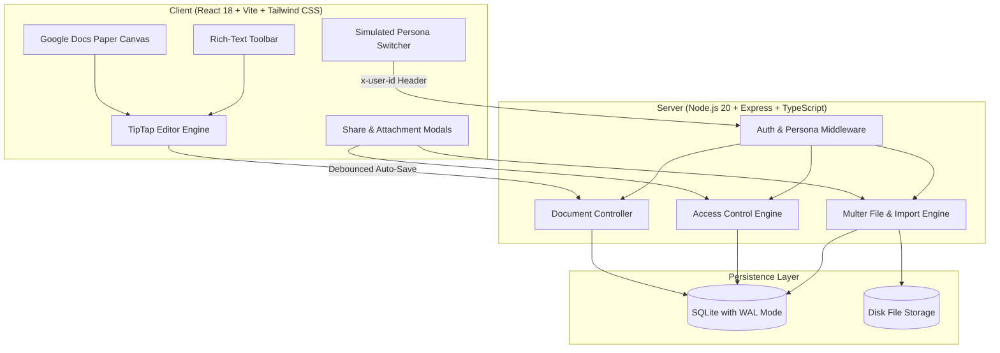
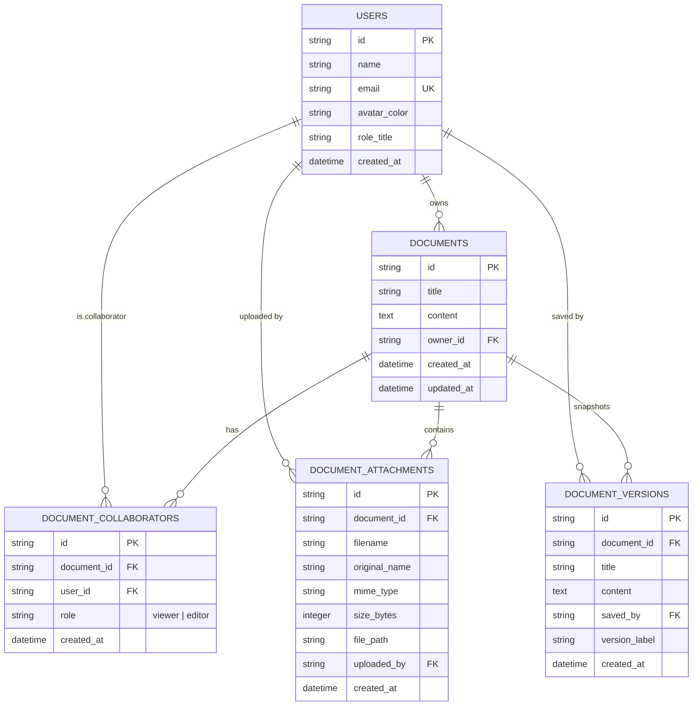

# System Architecture & Technical Design Note
**Product:** Ajaia Docs — AI-Native Collaborative Document Editor  
**Candidate:** Vaishnavi A S (`2023vaishnavi.as@vidyashilp.edu.in`)  
**Assignment Target:** Ajaia LLC — AI-Native Full Stack Developer  

---

## 1. Executive Summary & Philosophy

Ajaia Docs is a lightweight, responsive document workspace inspired by Google Docs, built within a strict 4-6 hour delivery timebox. The primary architectural objective was to deliver a **production-grade vertical slice** demonstrating sound product judgment, deterministic access control, robust persistence, and multi-format file handling rather than an overextended or brittle prototype.

---

## 2. Data Model & Schema Design

Relational integrity is enforced using foreign keys with cascading deletions, indexes on queried relationships, and check constraints.

### Key Schema Characteristics
1. **Compound Unique Index:** `document_collaborators(document_id, user_id)` guarantees a user cannot have duplicate conflicting roles on the same document.
2. **Foreign Key Constraints (`PRAGMA foreign_keys = ON`):** Deleting a document automatically cleans up associated collaborators, attachments, and version snapshots.
3. **Write-Ahead Logging (`PRAGMA journal_mode = WAL`):** Allows concurrent readers and writers without database locking conflicts.

---

## 3. Access Control & Authorization Matrix

A key requirement of the assignment is demonstrating clear intent, working logic, and visible distinction between owned and shared assets.

| Capability | Document Owner | Shared: Editor | Shared: Viewer | Non-Collaborator |
| :--- | :---: | :---: | :---: | :---: |
| **View Document** | ✅ Yes | ✅ Yes | ✅ Yes | ❌ 403 Forbidden |
| **Edit Content** | ✅ Yes | ✅ Yes | ❌ 403 Forbidden | ❌ 403 Forbidden |
| **Rename Title** | ✅ Yes | ✅ Yes | ❌ 403 Forbidden | ❌ 403 Forbidden |
| **Attach Files** | ✅ Yes | ✅ Yes | ❌ 403 Forbidden | ❌ 403 Forbidden |
| **Download Files** | ✅ Yes | ✅ Yes | ✅ Yes | ❌ 403 Forbidden |
| **Manage Sharing** | ✅ Yes | ❌ 403 Forbidden | ❌ 403 Forbidden | ❌ 403 Forbidden |
| **Delete Document** | ✅ Yes | ❌ 403 Forbidden | ❌ 403 Forbidden | ❌ 403 Forbidden |
| **Restore Version** | ✅ Yes | ✅ Yes | ❌ 403 Forbidden | ❌ 403 Forbidden |

### Dynamic User Simulation
Reviewers can switch between seeded accounts directly from the top navigation bar (`Vaishnavi`, `Alex`, `Priya`, `Sam`). When switching:
- The `x-user-id` header updates in the client API layer.
- The UI immediately recalculates access rules:
  - If a user has `viewer` rights, the editor switches to read-only mode with an amber warning banner.
  - If a user lacks access to an open document, the system safely redirects back to the dashboard with an explanatory toast notification.

---

## 4. Key Architectural Tradeoffs & Prioritization

Under a 4-6 hour constraint, conscious scope cuts are essential:

### 1. Persistence & Editing Sync: Debounced REST vs. Operational Transformation / CRDT
- **Decision:** Implemented debounced HTTP persistence (1.5-second inactivity trigger) combined with explicit manual `Ctrl+S` saving.
- **Tradeoff Rationale:** Full CRDTs (like Yjs or Automerge) over WebSockets introduce significant complexity around conflict resolution, presence heartbeats, and database persistence mapping. Within this timebox, building a rock-solid, verifiable HTTP persistence engine with automated snapshotting is vastly superior to a half-working WebSocket implementation prone to desynchronization.

### 2. Editor Framework: TipTap (ProseMirror) vs. Raw `contenteditable`
- **Decision:** Utilized `@tiptap/react` with the `StarterKit`, `Underline`, `TextAlign`, and `Placeholder` extensions.
- **Tradeoff Rationale:** Browser-native `contenteditable` produces inconsistent markup across operating systems (e.g., `
` vs. `
`, nested `<b>` vs. `<strong>`). TipTap enforces a clean, deterministic abstract syntax tree and outputs predictable, standard-compliant semantic HTML.

### 3. Database: Embedded SQLite (WAL) vs. Hosted Cloud Postgres
- **Decision:** Chose embedded SQLite with `better-sqlite3`.
- **Tradeoff Rationale:** Zero configuration for evaluators. Reviewers can clone the repo and run `npm test` or `npm run dev` in 10 seconds without needing Docker, connection strings, or paid external database provisioning.

### 4. File Workflow: Markdown Ingestion & Multi-Format Attachments
- **Decision:** Built a multi-pronged file system:
  1. **Document Ingestion:** Parses uploaded `.md`, `.txt`, `.html`, or `.json` files into rich documents with converted headings, lists, bold text, and code blocks.
  2. **Document Attachments:** Allows documents to hold supplementary assets (PDFs, spreadsheets, mockups) with secure download endpoints and disk storage.
  3. **Round-Trip Export:** Users can download their edited documents as Markdown, HTML, or print-ready PDF.

---

## 5. Security & Verification
- **Input Validation:** All write endpoints use Zod schemas to reject invalid inputs (e.g. empty titles, malformed emails).
- **Automated Test Coverage:** 16 Vitest integration tests verify document CRUD, role permissions, file ingestion, and boundary enforcement.
- **Error Handling:** Standardized error envelopes `{ error, details }` paired with non-intrusive UI toast notifications.
